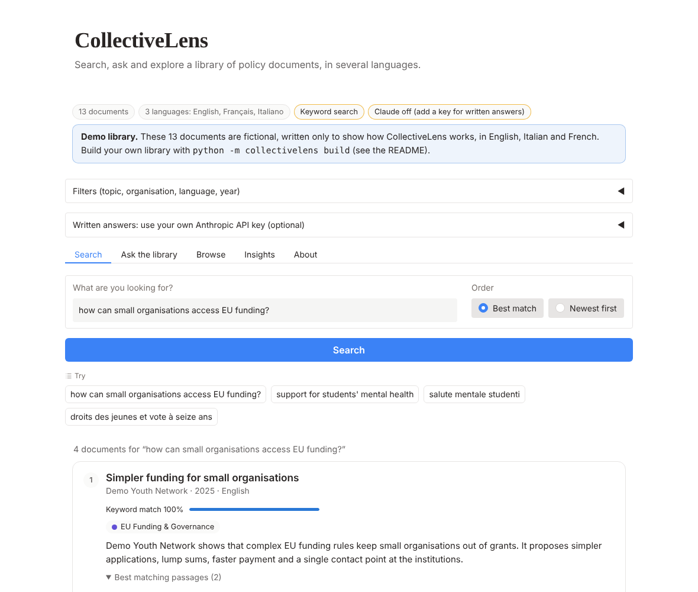
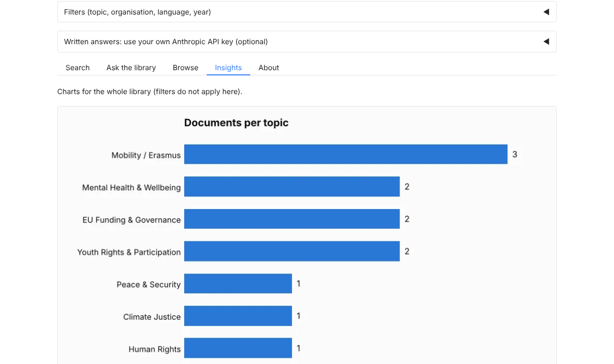

# CollectiveLens

Search, ask and explore a library of NGO policy documents, in several languages.

CollectiveLens is an applied AI prototype for umbrella NGOs and networks whose member organisations publish position papers and reports in different languages. It turns a folder of PDFs into a library you can search by meaning, question with cited answers, filter by policy area, organisation and year, and see from above.

Project presentation (Canva): https://www.canva.com/design/DAG7GegjF4M/UsZhMf7yoW_mk_prg-S3sg/view

**Status:** version 2.0, a prototype and not production software. Version 1, the notebook I built as the capstone of the Applied AI Bootcamp by allWomen, is kept unchanged in [`legacy/`](legacy/) and tagged `v1.0-bootcamp`. [`docs/what-changed.md`](docs/what-changed.md) explains every change from version 1 to version 2 in plain language, and why I made it.

<!-- Live demo: add the link to the Hugging Face Space here once it is online. -->



*Screenshot taken with the demo library, in keyword mode and without a Claude key. With the semantic model, a question in one language can also find documents in another.*

## The problem

Umbrella NGOs coordinate many member organisations that publish reports, position papers and policy briefs across countries, languages and years. In practice this knowledge is scattered across folders and websites, hard to search by meaning, rarely compared and underused for advocacy.

## What it does

1. **Reads your documents.** PDF, text and Markdown files are read, the language of each is detected, and a small metadata table adds title, organisation and year.
2. **Summarises them.** Claude writes a two to three sentence English summary of each document, once, and the result is cached.
3. **Splits them into passages** of about 180 words, so that every part of a document can be found and not only its opening.
4. **Search.** A question is matched with passages. Results show the best matching passages with the matched words marked, filtered by topic, organisation, language and year.
5. **Ask the library.** Claude answers a question using only the retrieved passages and cites them as [1], [2]. Citations that point to nothing are removed. Without a key, the app shows the matching passages instead.
6. **Topics and groups.** Each document gets the closest of eight policy areas (the list is a file you can edit) and is placed in an automatically found group described by its distinguishing words.
7. **Insights.** Charts of topics, topics by year, organisations, and a map of the library.



## Try it in two minutes

You need Python 3.12 (3.10 to 3.13 should work; do not use the very newest release, see Troubleshooting). The demo library is included: 13 **fictional** documents in English, Italian and French, written only to show how the app works.

```bash
git clone https://github.com/fabianamaraffa/CollectiveLens.git
cd CollectiveLens
python -m venv .venv && source .venv/bin/activate    # on Windows: .venv\Scripts\activate
pip install -r requirements.txt
python app.py
```

Open http://127.0.0.1:7860. The first start downloads the multilingual search model (about 2 GB) and takes a few minutes. To skip the download and use plain keyword matching, run `COLLECTIVELENS_EMBEDDER=lite python app.py`. The status line at the top of the app always says which mode you are in.

If the semantic model cannot run on your computer, the app does not close: it switches to keyword matching and says why in the status line.

Written answers need an Anthropic API key. Put it in a `.env` file (see `.env.example`) or paste it in the app under "Written answers". Without a key everything else works.

### Troubleshooting

- **The terminal says `Could not open requirements file`:** you are not in the project folder. Use `cd` to enter the folder that contains `app.py`.
- **`pip` or `gradio` complains about the Python version:** Gradio 6 needs Python 3.10 or newer. The Python that comes with macOS is 3.9, so install 3.12 from python.org and use `python3.12 -m venv .venv`.
- **The app closes with a crash report (`Python quit unexpectedly`, `SIGABRT`) while loading the model:** this was reported with Python 3.15, whose PyTorch build is too new to be reliable. Delete the `.venv` folder, install Python 3.12 and start again. Version 2.0.1 of the app checks PyTorch in a separate process first and falls back to keyword matching instead of closing.
- **You only want to look at the interface:** start with `COLLECTIVELENS_EMBEDDER=lite python app.py` (on Windows: `set COLLECTIVELENS_EMBEDDER=lite` and then `python app.py`). Nothing is downloaded and PyTorch is not used.

## Use your own documents

1. Put your PDFs in a folder, for example `pdfs/`.
2. Create `metadata.csv` with the columns `file_name`, `title`, `member_org`, `publication_year` and, if you have it, `source_url`. The `file_name` value is matched to each file name (the `.pdf` ending is optional).
3. Build the library:

   ```bash
   export ANTHROPIC_API_KEY=...      # optional: needed only for the summaries
   python -m collectivelens build --input pdfs/ --metadata metadata.csv
   ```

   This creates `library/` (ignored by git, because it holds the full text of your documents). Files that cannot be read are skipped with a message, and scanned PDFs without text need OCR first.
4. Start the app with `python app.py`. It opens `library/` when it exists and the demo library otherwise.

To check the automatic topics, add a `gold_topic` column to the metadata with the topic a person would choose for some documents, then run `python -m collectivelens eval`. It reports how often the two agree and lists the disagreements. To use CollectiveLens in another field, edit [`collectivelens/categories.yaml`](collectivelens/categories.yaml).

Other commands: `python -m collectivelens search "your question"` searches from the terminal, and `python -m collectivelens --help` lists everything. If you already have summaries from version 1, pass them with `--summaries-file raw_documents.json` and they are reused instead of paid for again.

## Settings

All settings are optional environment variables (see `.env.example`).

| Variable | Purpose | Default |
|---|---|---|
| `ANTHROPIC_API_KEY` | Summaries and written answers | none |
| `COLLECTIVELENS_CLAUDE_MODEL` | Claude model | `claude-haiku-5-5` |
| `COLLECTIVELENS_EMBEDDER` | `auto`, `semantic` or `lite` | `auto` (semantic model, falling back to keywords with a visible notice) |
| `COLLECTIVELENS_EMBEDDING_MODEL` | Search model | `BAAI/bge-m3` |
| `COLLECTIVELENS_DEVICE` | Where the search model runs: `cpu` (safest), `mps` (Apple chips) or `cuda` | `cpu` |
| `COLLECTIVELENS_SKIP_PROBE` | `1` skips the PyTorch safety check at start | off |
| `COLLECTIVELENS_LIBRARY` | Library folder to open | `./library`, else the demo library |
| `COLLECTIVELENS_CATEGORIES` | Your own categories file | the bundled one |
| `COLLECTIVELENS_DAILY_LIMIT` | Calls per day made with the server's own key | 40 |
| `COLLECTIVELENS_SHARE` | `1` creates a temporary public link | off |

## Privacy

Search, topics, groups and charts run on your machine. Claude is used for two things: summaries (the document text is sent to the Anthropic API) and answers (the question and the retrieved passages are sent). Do not use confidential documents unless your data policy allows it. A key pasted into the app is used for that session only and is not saved. Version 1 created a public link on every launch; version 2 does not, unless you ask for it.

## Limits

- **Topics are a first pass.** They come from comparing each document with a one-line description of each area, and they can be wrong. The app shows a similarity and flags documents that sit between two topics, and `eval` measures agreement with your own labels. On the demo library, whose documents I wrote to fit the topics, keyword mode agrees on 12 of 13: a smoke test and not evidence of accuracy. I have not yet measured agreement on the original 93 documents.
- **Answers can be wrong.** They are limited to the retrieved passages and must cite them, but check the cited passages before relying on an answer.
- **Cross-language search depends on the semantic model.** The model is multilingual, but I have not yet measured how well it works across my languages. In keyword mode, only shared words match.
- **The eight categories are about youth, education and EU policy**, because that was the corpus of version 1.
- **The original library is not included.** It belongs to the member organisations that wrote the documents.

## Tests

`python -m pytest` runs the 71 automated tests in a few seconds. They cover reading files, passages, search, topics, groups, citations, caching, the command line and the HTML the app produces, using keyword mode, a fake embedding model and a fake Claude client. They run on GitHub on every push. They do not call the real semantic model or the real Claude API, so run the app once with your key to check those parts on your machine.

## Repository

```
app.py                     starts the web app (also the entry point on Hugging Face Spaces)
collectivelens/            the package: ingest, passages, search, ask, topics, charts, interface
  categories.yaml          the policy areas (edit this for another field)
data/sample/               the fictional demo library and its source files
docs/what-changed.md       what changed from version 1 and why
docs/deploy-hugging-face.md   how to put the demo online for free
legacy/                    version 1, unchanged (notebook, original README, screenshots)
tests/                     automated tests
CHANGELOG.md               list of changes by version
```

## Next steps

- Measure topic agreement and search quality on a hand-labelled sample of the original library.
- Compare the semantic model with a lighter one for small free servers.
- Add OCR for scanned PDFs.

## How I built this

I am not an engineer. I wrote the code with the help of LLMs, and I can follow what it does thanks to the Applied AI Bootcamp by allWomen. Version 2 was written with Claude: I set the goals and the choices (keep the original, a free online demo, a fictional demo library), and Claude wrote and tested the code. [`docs/what-changed.md`](docs/what-changed.md) lists what was changed and what could not be checked.

## Disclaimer

Version 1 was developed as part of the Applied AI Bootcamp by allWomen, as an educational prototype to explore design choices, trade-offs and responsible use of AI in a policy and NGO context. Thanks to allWomen for the training, guidance and support.

Author: Fabiana Maraffa. License: MIT.
