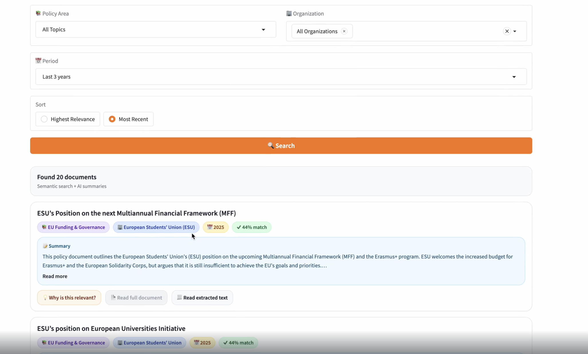
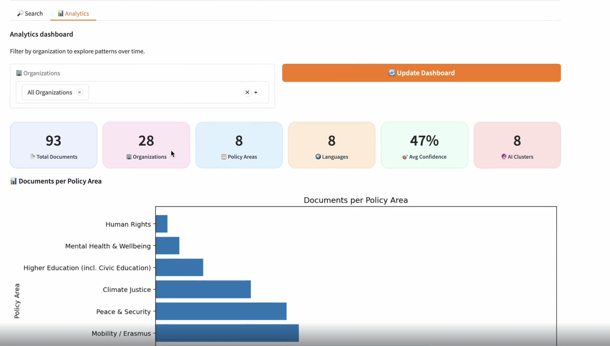

> **This is version 1 of CollectiveLens, kept unchanged as a record of the bootcamp prototype (git tag `v1.0-bootcamp`).**
> The current version is described in the [main README](../README.md), and [what changed](../docs/what-changed.md) explains the differences.
> Known issues of this version: the README below mentions methods that are not in the code (BART, HDBSCAN, TF-IDF, UMAP), and the two Claude models it used have been retired.
> The notebook in this folder is a cleaned copy (no keys or account details, current default model); it has not been re-run on the original library.

---

# CollectiveLens – AI-powered Knowledge Intelligence for NGO Networks

CollectiveLens is an **Applied AI prototype** designed to help umbrella NGOs and networks transform fragmented policy documents into a **searchable, multilingual collective intelligence system**.

The project demonstrates how modern NLP and machine learning techniques can be combined—under realistic data, cost, and deployment constraints—to support **evidence-based advocacy, coordination, and decision-making**.

🔗 **Project presentation (Canva):** https://www.canva.com/design/DAG7GegjF4M/UsZhMf7yoW_mk_prg-S3sg/view

---

## 🎯 Problem Statement

Umbrella NGOs coordinate dozens of member organisations that produce reports, position papers, and policy briefs across countries, languages, and years.

In practice, this knowledge is often:
- scattered across folders and websites  
- difficult to search semantically  
- rarely compared or synthesised  
- underused for advocacy and policy engagement  

As a result, institutional knowledge is fragmented, duplicated, and slow to mobilise.

**CollectiveLens addresses this gap** by converting unstructured PDF documents into a shared, AI-powered knowledge layer.

---

## 🚀 Key Features

- **PDF Processing**  
  Extracts text from policy PDFs using `pdfplumber`, optimised for NGO-style documents and notebook-based environments.

- **Semantic Text Representation**  
  Uses a multilingual transformer model (`SentenceTransformers`) to encode documents as semantic embeddings, enabling meaning-based analysis across languages.

- **Topic Classification (Zero-Shot)**  
  Assigns documents to policy areas using cosine similarity between document embeddings and category descriptions—no labeled data required.

- **Document Clustering**  
  Groups documents into thematic clusters using **KMeans**, with **HDBSCAN used as a validation step** to assess cluster structure and data heterogeneity.

- **Keyword & Topic Labeling**  
  Applies **TF-IDF (with bigrams)** to extract interpretable keywords and policy-relevant phrases for each cluster.

- **Summarisation (Hybrid Approach)**  
  - **BART (local, open-source)** for offline and privacy-preserving summaries  
  - **Claude (Anthropic API)** for high-quality, policy-grade abstractive summaries when nuance matters  

- **Semantic Search & Filtering**  
  Combines semantic similarity with metadata filters to support intuitive, policy-oriented information retrieval.

- **Interactive Demo**  
  Includes a lightweight **Gradio interface** for exploration and demonstration.

---

## 🧠 Technical Overview

### AI Pipeline

1. **PDF Extraction** – `pdfplumber`  
2. **Text Embeddings** – `SentenceTransformers (paraphrase-multilingual-MiniLM-L12-v2)`  
3. **Topic Classification** – Zero-shot cosine similarity  
4. **Clustering** – KMeans (validated with HDBSCAN)  
5. **Keyword Extraction** – TF-IDF (unigrams + bigrams)  
6. **Summarisation** – BART (local) + Claude (LLM)  
7. **Search & UI** – Semantic similarity + Gradio  

---

## 🔍 Design Choices & Trade-offs

This project intentionally balances **quality, cost, privacy, and feasibility**, reflecting real-world NGO constraints.

Examples:
- **KMeans** was chosen for clustering to ensure full document coverage, while **HDBSCAN** was used to validate cluster density and identify heterogeneity.
- **Zero-shot classification** was preferred due to the absence of labeled training data.
- **TF-IDF** was selected for keyword extraction for its transparency and low computational cost.
- **Hybrid summarisation** allows sensitive documents to be processed locally, while higher-quality LLM summaries are used selectively.

These decisions are discussed and demonstrated directly in the notebook.

---

## 📁 Repository Contents

- `CollectiveLens_COMPLETE_FIXED_public.ipynb` – Main end-to-end notebook  

This repository does **not** include the original document corpus.

---
## 🎤 Presentation

The project presentation is available at the following link:

👉 **Canva presentation:**  
https://www.canva.com/design/DAG7GegjF4M/UsZhMf7yoW_mk_prg-S3sg/view

The presentation explains the problem context, design choices, and results for a non-technical audience.

---

## 🔐 Data & Privacy

- All processing can run locally  
- External APIs (Claude) are **optional** and clearly isolated  

---

## 📌 Disclaimer

This project was developed as part of an **Applied AI Bootcamp by allWomen**.  
It is an educational prototype created to explore design choices, trade-offs, and responsible use of AI techniques in a real-world policy and NGO context.

The author would like to thank **allWomen** for the training, guidance, and support provided throughout the programme.

## 🖥️ Prototype Preview

Below are example screenshots from the interactive prototype built with Gradio.

### Semantic Search & Summarisation Interface

### Analysis Dashboard

